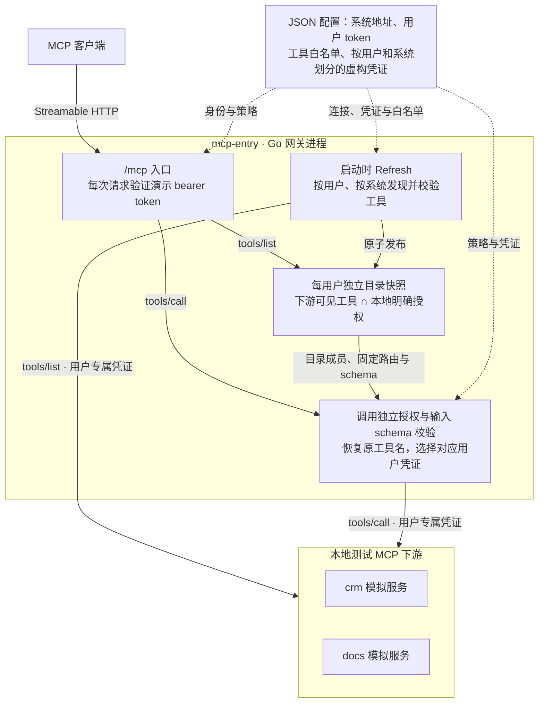
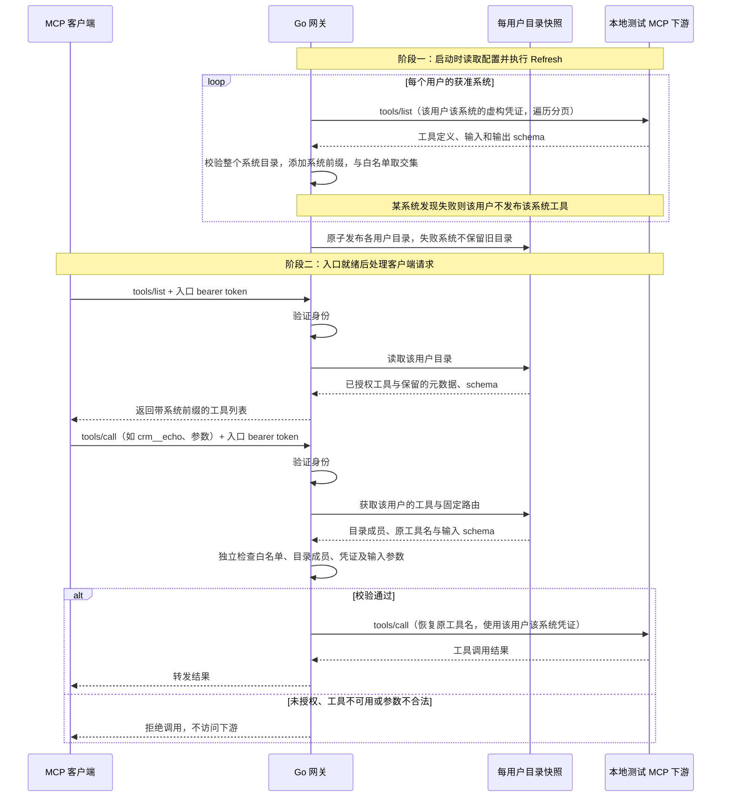

# mcp-entry

A nonproduction Go MCP gateway: config-driven downstream discovery, per-user tool catalogs, explicit authorization, and isolated synthetic credentials. Uses the official MCP SDK and Streamable HTTP. Local demo only; no OAuth or real account binding yet.

## 当前架构

当前是单个 Go 网关进程，使用官方 MCP SDK 与 Streamable HTTP。下图只展示已实现部分；入口和下游均限回环 HTTP，配置只使用虚构测试身份与凭证。OAuth、账号绑定、凭证保险库与管理界面尚未实现。



公开工具名采用 `系统名__原工具名`，例如 `crm__echo`；客户端不能用名称或参数改变下游地址。图中的模块是进程内逻辑，不是额外部署的服务。`cmd/demo` 会启动 crm、docs 模拟服务；`cmd/gateway` 只启动网关，下游需预先运行。

## 发现与请求流程

启动发现与客户端请求是两个阶段。`tools/list` 读取已发布快照，`tools/call` 使用已发现的路由和 schema，不会每次重新发现目录。身份验证失败会立即拒绝请求；以下省略 MCP 连接初始化细节，展示身份有效后的目录与调用路径。



当前命令只在启动时刷新；修改配置或下游工具后需重启。发现失败可以留下其他健康系统的可用目录，但不会放宽授权。详细边界见 [架构与威胁模型](docs/architecture.md)。

## 已实现

- JSON 配置系统连接与用户策略；使用用户自己的下游凭证执行真实 `tools/list`。
- 标准 MCP 工具发现与调用，不引入自定义搜索协议。
- 稳定名称为 `系统名__原工具名`；转发时恢复原工具名，不把路由信息交给客户端控制。
- 每个用户单独建立目录，只有「下游实际可见 ∩ 本地明确授权」的工具会发布。
- 保留工具描述、输入/输出 schema 及 SDK 支持的元数据；不再假定工具都接受 message 参数。
- 调用独立检查身份、策略、目录成员及输入 schema，并按用户和系统选择凭证。
- 分页、重复名称、恶意名称、异常 schema、下游不可用及目录大小都有边界处理。
- 单个用户的某个系统发现失败时，该系统目录整体不发布；其他健康系统仍可使用。刷新失败不会保留旧目录。

## 快速演示

需要 Go 1.25 或更新版本。官方 SDK 固定为 v1.7.0，依赖校验在 go.sum 中。

```sh
go mod download
go run ./cmd/demo
```

demo 命令显式启动两个模拟下游 crm、docs，再执行真实发现。它只监听回环地址，网关位于 `http://127.0.0.1:8080/mcp`。

在支持 Streamable HTTP 的 MCP 客户端中设置：
- alice：`Authorization: Bearer demo-alice`，可见 `crm__echo`、`docs__echo`。
- bob：`Authorization: Bearer demo-bob`，仅可见 `crm__echo`。

两个模拟下游使用随机回环端口，均不连接真实业务。Ctrl+C 关闭所有演示服务。

## 配置驱动入口

```sh
go run ./cmd/gateway -config configs/demo.json -listen 127.0.0.1:8080
```

这个命令只启动网关，不会自动启动任何下游。示例配置中的 9001、9002 是占位的本地 MCP 地址；需先自行运行对应模拟 MCP 服务，或替换为已运行的本地测试服务地址与虚构凭证。若地址不可用，网关会报告发现失败，并提供空的或部分可用的目录，不会假装连接成功。

配置包括：
- systems：唯一系统名、字面回环 HTTP 地址及可选下游认证头模式（默认 Bearer，另支持 raw Authorization 和 API-key header），见 [下游凭证请求头](docs/downstream-auth.md)。
- users：虚构身份、入口 token、完整工具名白名单，以及按系统索引的模拟下游 token。

个人测试配置请复制为 `configs/dev.local.json`；除公开虚构示例 `configs/demo.json` 外，configs 下 JSON 配置默认忽略。不要在示例中填入真实凭证；gitignore 不是凭证保护或保险库。

没有通配授权。配置中允许但下游未公布的工具不会出现，也不能调用。当前命令仅在启动时刷新目录；修改配置或下游工具后需重启。库中的 Refresh 可供测试及后续管理层调用，目前没有管理 API 或后台刷新任务。

## 检查

```sh
go test -count=1 ./...
go test -race -count=1 ./...
go vet ./...
go build ./...
```

CI 使用 go.mod 的 Go 版本执行格式、模块验证、测试、race、vet 和构建。实现和验证边界见 [架构与威胁模型](docs/architecture.md)、[工具契约与传输兼容性](docs/compatibility.md) 与 [验证记录](docs/acceptance.md)。

## 原型限制与计划

产品范围、里程碑与反馈处理原则见 [路线图](docs/roadmap.md)。

固定明文 token 只是演示身份，不是可信生产认证。仅允许回环 HTTP，拒绝所有浏览器 Origin、跨目标重定向、外部/动态 schema 引用及递归引用，不适用于部署公网服务。工具描述、注解与返回内容仍是不可信外部数据；不提供提示注入净化保证。

尚未完成：OAuth/OIDC、安全网页账号绑定、持久化加密凭证库、管理界面、真实系统集成、动态撤权、审计和限流、生产 TLS 与密钥轮换。不代理 resources、prompts、sampling、任务扩展或任意远程 MCP 地址。已支持[有界的同文档 schema 引用](docs/schema-references.md)，后续持续完善兼容性回归，并单独设计真实认证和凭证持久化；当前不启用真实写操作。

## 协议依据

2026-10-22 核对官方 [Go SDK](https://github.com/modelcontextprotocol/go-sdk) 与 [v1.7.0 go.mod](https://github.com/modelcontextprotocol/go-sdk/blob/v1.7.0/go.mod)。SDK 支持 MCP 2026-07-28，并兼容 2025-11-25、2025-06-18、2025-03-26 和 2024-11-05。这里使用其 tools/list、tools/call 和 Streamable HTTP 子集，不声称全协议一致性认证。

项目许可证尚未选定，暂不添加 LICENSE。第三方依赖遵循各自许可证。
